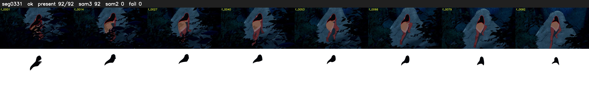

# Segment 331 (shot)

Film frames 29482-29573 (92 frames, 20:29.6-21:33.5).

**Status: ok**

| | |
|---|---|
| Frames with her hair | 92 / 92 |
| Mask source | SAM3 92, SAM2 fallback 0 |
| Frames still failing QC | 0 [] |
| Film indices with no picture (held) | 0 |
| Time | 141 s |

Top: source with the final mask outlined in red. Bottom: white-fill output.
