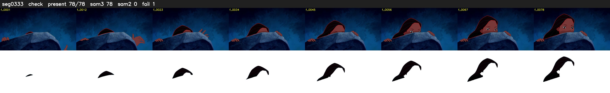

# Segment 333 (shot)

Film frames 29614-29691 (78 frames, 21:35.2-21:38.4).

**Status: check**

| | |
|---|---|
| Frames with her hair | 78 / 78 |
| Mask source | SAM3 78, SAM2 fallback 0 |
| Frames still failing QC | 1 [2] |
| Film indices with no picture (held) | 0 |
| Time | 117 s |

Top: source with the final mask outlined in red. Bottom: white-fill output.

## Issues

- fallback 2-2: no seed prompts (cleaned seed too small (3259 px): hair lost)
- other characters' hair erased on 2 frames
