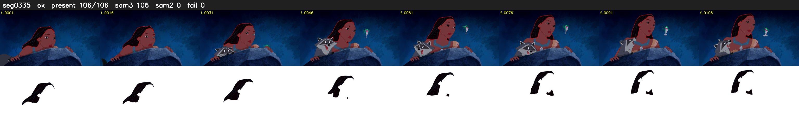

# Segment 335 (shot)

Film frames 29878-29983 (106 frames, 21:46.2-21:50.6).

**Status: ok**

| | |
|---|---|
| Frames with her hair | 106 / 106 |
| Mask source | SAM3 106, SAM2 fallback 0 |
| Frames still failing QC | 0 [] |
| Film indices with no picture (held) | 0 |
| Time | 158 s |

Top: source with the final mask outlined in red. Bottom: white-fill output.
