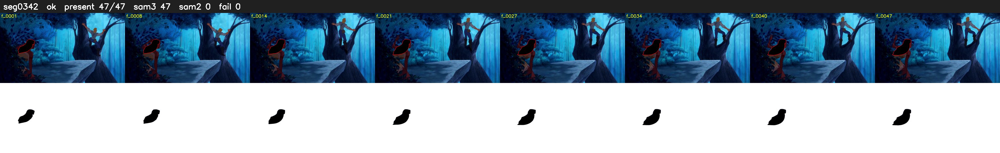

# Segment 342 (shot)

Film frames 30421-30467 (47 frames, 21:08.8-21:10.8).

**Status: ok**

| | |
|---|---|
| Frames with her hair | 47 / 47 |
| Mask source | SAM3 47, SAM2 fallback 0 |
| Frames still failing QC | 0 [] |
| Film indices with no picture (held) | 0 |
| Time | 77 s |

Top: source with the final mask outlined in red. Bottom: white-fill output.

## Issues

- dark scene: 74% of frames fail 'missed', missed QC off
