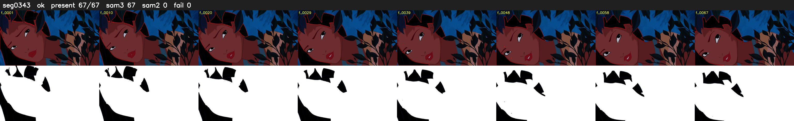

# Segment 343 (shot)

Film frames 30468-30534 (67 frames, 21:10.8-21:13.6).

**Status: ok**

| | |
|---|---|
| Frames with her hair | 67 / 67 |
| Mask source | SAM3 67, SAM2 fallback 0 |
| Frames still failing QC | 0 [] |
| Film indices with no picture (held) | 0 |
| Time | 108 s |

Top: source with the final mask outlined in red. Bottom: white-fill output.

## Issues

- dark scene: 100% of frames fail 'missed', missed QC off
