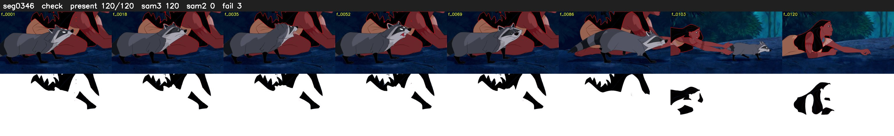

# Segment 346 (shot)

Film frames 30698-30817 (120 frames, 21:20.4-21:25.4).

**Status: check**

| | |
|---|---|
| Frames with her hair | 120 / 120 |
| Mask source | SAM3 120, SAM2 fallback 0 |
| Frames still failing QC | 3 [72, 73, 92] |
| Film indices with no picture (held) | 0 |
| Time | 286 s |

Top: source with the final mask outlined in red. Bottom: white-fill output.

## Issues

- other characters' hair erased on 28 frames
