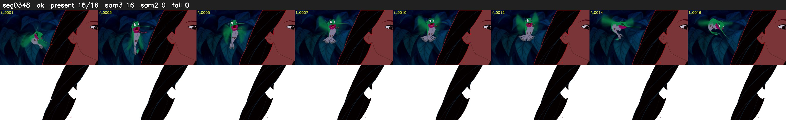

# Segment 348 (shot)

Film frames 30858-30873 (16 frames, 21:27.0-21:27.7).

**Status: ok**

| | |
|---|---|
| Frames with her hair | 16 / 16 |
| Mask source | SAM3 16, SAM2 fallback 0 |
| Frames still failing QC | 0 [] |
| Film indices with no picture (held) | 0 |
| Time | 25 s |

Top: source with the final mask outlined in red. Bottom: white-fill output.
