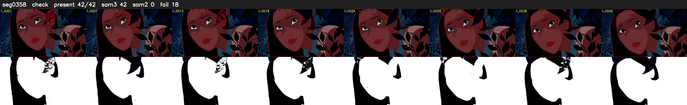

# Segment 358 (shot)

Film frames 31593-31634 (42 frames, 22:57.7-22:59.4).

**Status: check**

| | |
|---|---|
| Frames with her hair | 42 / 42 |
| Mask source | SAM3 42, SAM2 fallback 0 |
| Frames still failing QC | 18 [1, 2, 13, 14, 21, 22, 23, 24, 25, 26, 27, 28, 29, 30, 31, 32, 33, 34] |
| Film indices with no picture (held) | 0 |
| Time | 87 s |

Top: source with the final mask outlined in red. Bottom: white-fill output.

## SAM2 fallbacks

| Frames | Anchor | Direction | SAM2 used |
|---|---|---|---|
| 1-2 | 3 | backward | 0/2 |
| 13-14 | 12 | forward | 0/2 |
| 21-34 | 20 | forward | 0/14 |
