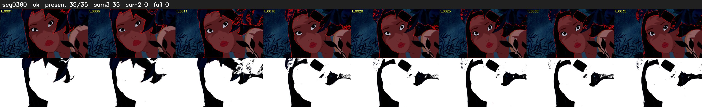

# Segment 360 (shot)

Film frames 31721-31755 (35 frames, 22:03.0-22:04.5).

**Status: ok**

| | |
|---|---|
| Frames with her hair | 35 / 35 |
| Mask source | SAM3 35, SAM2 fallback 0 |
| Frames still failing QC | 0 [] |
| Film indices with no picture (held) | 0 |
| Time | 72 s |

Top: source with the final mask outlined in red. Bottom: white-fill output.

## Issues

- dark scene: 100% of frames fail 'missed', missed QC off
