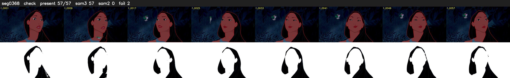

# Segment 368 (shot)

Film frames 32301-32357 (57 frames, 22:27.2-22:29.6).

**Status: check**

| | |
|---|---|
| Frames with her hair | 57 / 57 |
| Mask source | SAM3 57, SAM2 fallback 0 |
| Frames still failing QC | 2 [25, 26] |
| Film indices with no picture (held) | 0 |
| Time | 88 s |

Top: source with the final mask outlined in red. Bottom: white-fill output.
