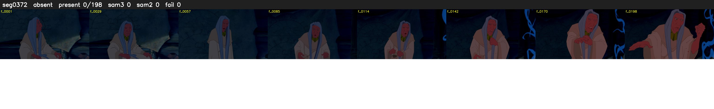

# Segment 372 (shot)

Film frames 32921-33118 (198 frames, 23:53.1-23:01.3).

**Status: absent**

| | |
|---|---|
| Frames with her hair | 0 / 198 |
| Mask source | SAM3 0, SAM2 fallback 0 |
| Frames still failing QC | 0 [] |
| Film indices with no picture (held) | 0 |
| Time | 61 s |

Top: source with the final mask outlined in red. Bottom: white-fill output.

## Issues

- hair on 33/33 presence frames, none of it hers (best P 0.01)
