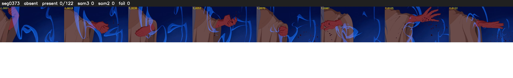

# Segment 373 (shot)

Film frames 33119-33240 (122 frames, 23:01.3-23:06.4).

**Status: absent**

| | |
|---|---|
| Frames with her hair | 0 / 122 |
| Mask source | SAM3 0, SAM2 fallback 0 |
| Frames still failing QC | 0 [] |
| Film indices with no picture (held) | 0 |
| Time | 36 s |

Top: source with the final mask outlined in red. Bottom: white-fill output.

## Issues

- hair on 19/21 presence frames, none of it hers (best P 0.16)
