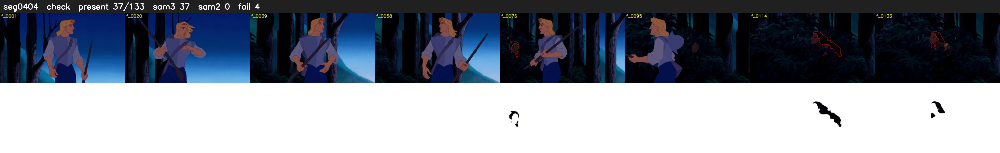

# Segment 404 (shot)

Film frames 36358-36490 (133 frames, 25:16.4-25:22.0).

**Status: check**

| | |
|---|---|
| Frames with her hair | 37 / 133 |
| Mask source | SAM3 37, SAM2 fallback 0 |
| Frames still failing QC | 4 [71, 75, 76, 103] |
| Film indices with no picture (held) | 0 |
| Time | 253 s |

Top: source with the final mask outlined in red. Bottom: white-fill output.

## Issues

- other characters' hair erased on 95 frames
