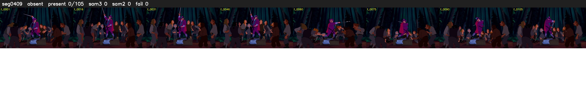

# Segment 409 (shot)

Film frames 37442-37546 (105 frames, 26:01.6-26:06.0).

**Status: absent**

| | |
|---|---|
| Frames with her hair | 0 / 105 |
| Mask source | SAM3 0, SAM2 fallback 0 |
| Frames still failing QC | 0 [] |
| Film indices with no picture (held) | 0 |
| Time | 56 s |

Top: source with the final mask outlined in red. Bottom: white-fill output.

## Issues

- hair on 18/18 presence frames, none of it hers (best P 0.10)
