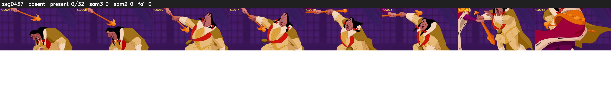

# Segment 437 (shot)

Film frames 39042-39073 (32 frames, 27:08.4-27:09.7).

**Status: absent**

| | |
|---|---|
| Frames with her hair | 0 / 32 |
| Mask source | SAM3 0, SAM2 fallback 0 |
| Frames still failing QC | 0 [] |
| Film indices with no picture (held) | 0 |
| Time | 10 s |

Top: source with the final mask outlined in red. Bottom: white-fill output.

## Issues

- hair on 6/6 presence frames, none of it hers (best P 0.01)
