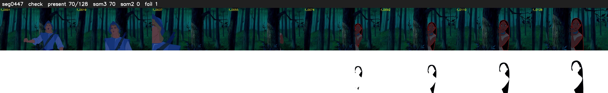

# Segment 447 (shot)

Film frames 39907-40034 (128 frames, 28:44.5-28:49.8).

**Status: check**

| | |
|---|---|
| Frames with her hair | 70 / 128 |
| Mask source | SAM3 70, SAM2 fallback 0 |
| Frames still failing QC | 1 [59] |
| Film indices with no picture (held) | 0 |
| Time | 226 s |

Top: source with the final mask outlined in red. Bottom: white-fill output.

## Issues

- dark scene: 66% of frames fail 'missed', missed QC off
- fallback 59-59: no seed prompts (cleaned seed too small (3952 px): hair lost)
- other characters' hair erased on 55 frames
