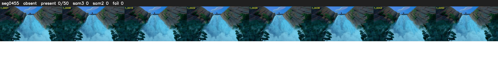

# Segment 455 (shot)

Film frames 40309-40358 (50 frames, 28:01.2-28:03.3).

**Status: absent**

| | |
|---|---|
| Frames with her hair | 0 / 50 |
| Mask source | SAM3 0, SAM2 fallback 0 |
| Frames still failing QC | 0 [] |
| Film indices with no picture (held) | 0 |
| Time | 17 s |

Top: source with the final mask outlined in red. Bottom: white-fill output.
