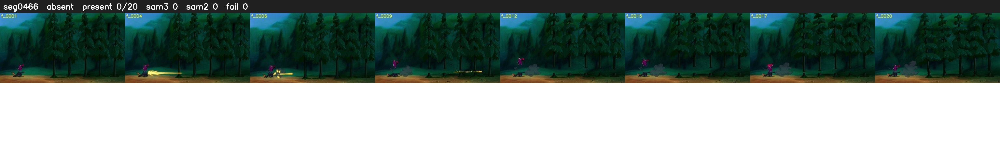

# Segment 466 (shot)

Film frames 41104-41123 (20 frames, 29:34.4-29:35.2).

**Status: absent**

| | |
|---|---|
| Frames with her hair | 0 / 20 |
| Mask source | SAM3 0, SAM2 fallback 0 |
| Frames still failing QC | 0 [] |
| Film indices with no picture (held) | 0 |
| Time | 8 s |

Top: source with the final mask outlined in red. Bottom: white-fill output.

## Issues

- hair on 3/4 presence frames, none of it hers (best P 0.00)
