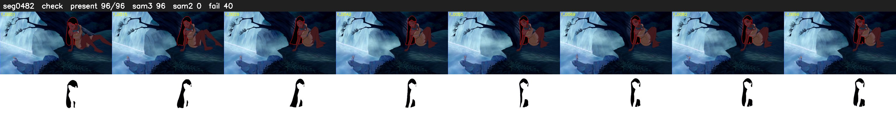

# Segment 482 (shot)

Film frames 42268-42363 (96 frames, 29:22.9-29:26.9).

**Status: check**

| | |
|---|---|
| Frames with her hair | 96 / 96 |
| Mask source | SAM3 96, SAM2 fallback 0 |
| Frames still failing QC | 40 [1, 2, 3, 4, 5, 6, 7, 8, 9, 10, 11, 12, 13, 14, 15, 16, 17, 18, 19, 20] |
| Film indices with no picture (held) | 0 |
| Time | 174 s |

Top: source with the final mask outlined in red. Bottom: white-fill output.

## SAM2 fallbacks

| Frames | Anchor | Direction | SAM2 used |
|---|---|---|---|
| 1-40 | 41 | backward | 0/40 |
