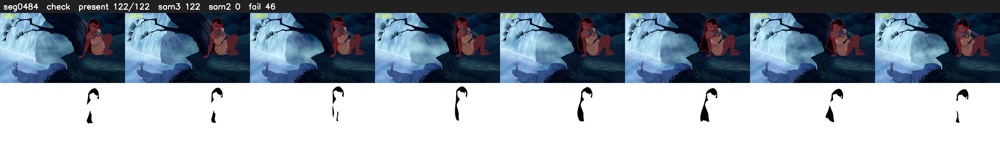

# Segment 484 (shot)

Film frames 42538-42659 (122 frames, 30:34.2-30:39.3).

**Status: check**

| | |
|---|---|
| Frames with her hair | 122 / 122 |
| Mask source | SAM3 122, SAM2 fallback 0 |
| Frames still failing QC | 46 [69, 70, 71, 72, 73, 74, 75, 76, 77, 78, 79, 80, 81, 82, 83, 84, 85, 86, 87, 88] |
| Film indices with no picture (held) | 0 |
| Time | 204 s |

Top: source with the final mask outlined in red. Bottom: white-fill output.
