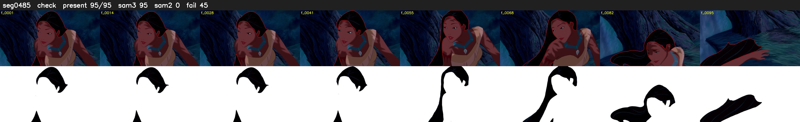

# Segment 485 (shot)

Film frames 42660-42754 (95 frames, 30:39.3-30:43.2).

**Status: check**

| | |
|---|---|
| Frames with her hair | 95 / 95 |
| Mask source | SAM3 95, SAM2 fallback 0 |
| Frames still failing QC | 45 [48, 49, 50, 51, 52, 53, 54, 55, 56, 57, 58, 59, 60, 61, 62, 63, 64, 65, 66, 67] |
| Film indices with no picture (held) | 0 |
| Time | 172 s |

Top: source with the final mask outlined in red. Bottom: white-fill output.

## Issues

- other characters' hair erased on 1 frames
