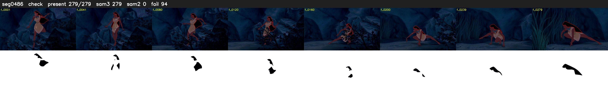

# Segment 486 (shot)

Film frames 42755-43033 (279 frames, 30:43.2-30:54.9).

**Status: check**

| | |
|---|---|
| Frames with her hair | 279 / 279 |
| Mask source | SAM3 279, SAM2 fallback 0 |
| Frames still failing QC | 94 [1, 2, 3, 4, 5, 6, 7, 8, 73, 74, 75, 76, 77, 78, 115, 116, 117, 118, 119, 120] |
| Film indices with no picture (held) | 0 |
| Time | 459 s |

Top: source with the final mask outlined in red. Bottom: white-fill output.

## Issues

- manual override: SAM2 f127-134 spilled onto her body/bushes (purity 0.47)
