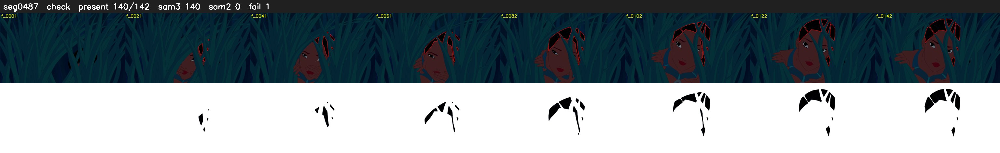

# Segment 487 (shot)

Film frames 43034-43175 (142 frames, 30:54.9-30:00.8).

**Status: check**

| | |
|---|---|
| Frames with her hair | 140 / 142 |
| Mask source | SAM3 140, SAM2 fallback 0 |
| Frames still failing QC | 1 [3] |
| Film indices with no picture (held) | 0 |
| Time | 222 s |

Top: source with the final mask outlined in red. Bottom: white-fill output.

## SAM2 fallbacks

| Frames | Anchor | Direction | SAM2 used |
|---|---|---|---|
| 3-3 | 4 | backward | 0/1 |

## Issues

- other characters' hair erased on 2 frames
