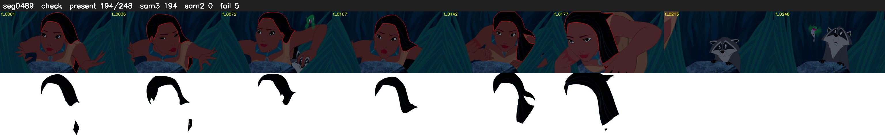

# Segment 489 (shot)

Film frames 43224-43471 (248 frames, 30:02.8-30:13.1).

**Status: check**

| | |
|---|---|
| Frames with her hair | 194 / 248 |
| Mask source | SAM3 194, SAM2 fallback 0 |
| Frames still failing QC | 5 [129, 130, 131, 132, 194] |
| Film indices with no picture (held) | 0 |
| Time | 402 s |

Top: source with the final mask outlined in red. Bottom: white-fill output.

## Issues

- other characters' hair erased on 48 frames
