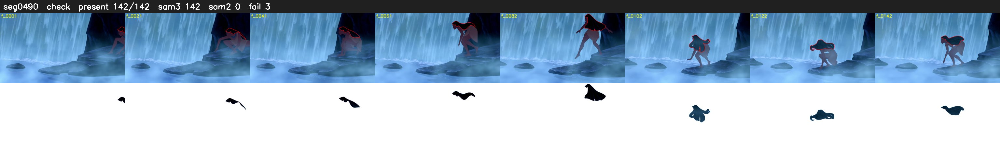

# Segment 490 (shot)

Film frames 43472-43613 (142 frames, 30:13.1-30:19.1).

**Status: check**

| | |
|---|---|
| Frames with her hair | 142 / 142 |
| Mask source | SAM3 142, SAM2 fallback 0 |
| Frames still failing QC | 3 [92, 93, 94] |
| Film indices with no picture (held) | 0 |
| Time | 210 s |

Top: source with the final mask outlined in red. Bottom: white-fill output.

## Issues

- dark scene: 58% of frames fail 'missed', missed QC off
