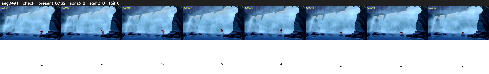

# Segment 491 (shot)

Film frames 43614-43675 (62 frames, 30:19.1-30:21.7).

**Status: check**

| | |
|---|---|
| Frames with her hair | 8 / 62 |
| Mask source | SAM3 8, SAM2 fallback 0 |
| Frames still failing QC | 6 [27, 28, 29, 30, 31, 32] |
| Film indices with no picture (held) | 0 |
| Time | 96 s |

Top: source with the final mask outlined in red. Bottom: white-fill output.

## Issues

- tinted scene: median hair purity 0.48 < 0.5, purity/missed QC off
- fallback 27-32: no seed prompts (cleaned seed too small (896 px): hair lost)
