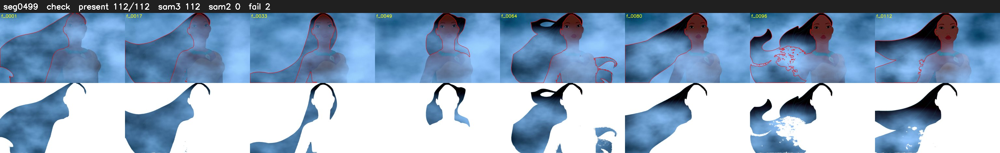

# Segment 499 (shot)

Film frames 44215-44326 (112 frames, 31:44.1-31:48.8).

**Status: check**

| | |
|---|---|
| Frames with her hair | 112 / 112 |
| Mask source | SAM3 112, SAM2 fallback 0 |
| Frames still failing QC | 2 [40, 42] |
| Film indices with no picture (held) | 0 |
| Time | 210 s |

Top: source with the final mask outlined in red. Bottom: white-fill output.

## Issues

- tinted scene: median hair purity 0.08 < 0.5, purity/missed QC off
