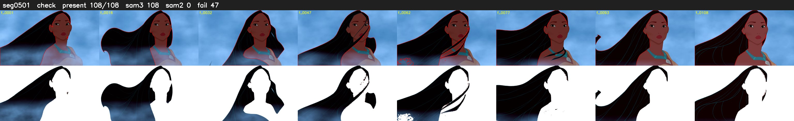

# Segment 501 (shot)

Film frames 44465-44572 (108 frames, 31:54.6-31:59.1).

**Status: check**

| | |
|---|---|
| Frames with her hair | 108 / 108 |
| Mask source | SAM3 108, SAM2 fallback 0 |
| Frames still failing QC | 47 [2, 3, 4, 5, 6, 7, 8, 9, 10, 11, 12, 13, 14, 15, 16, 17, 18, 19, 20, 21] |
| Film indices with no picture (held) | 0 |
| Time | 158 s |

Top: source with the final mask outlined in red. Bottom: white-fill output.

## Issues

- manual override: windy close-up: purity fails are blue highlights; SAM2 frames lose strands (f44, f50)
