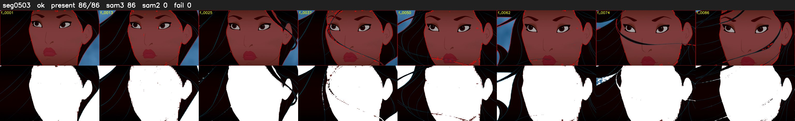

# Segment 503 (shot)

Film frames 44683-44768 (86 frames, 31:03.7-31:07.2).

**Status: ok**

| | |
|---|---|
| Frames with her hair | 86 / 86 |
| Mask source | SAM3 86, SAM2 fallback 0 |
| Frames still failing QC | 0 [] |
| Film indices with no picture (held) | 0 |
| Time | 142 s |

Top: source with the final mask outlined in red. Bottom: white-fill output.
