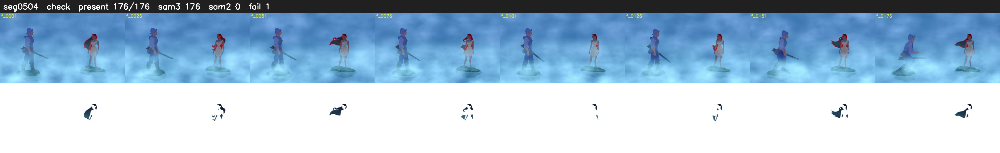

# Segment 504 (shot)

Film frames 44769-44944 (176 frames, 31:07.2-31:14.6).

**Status: check**

| | |
|---|---|
| Frames with her hair | 176 / 176 |
| Mask source | SAM3 176, SAM2 fallback 0 |
| Frames still failing QC | 1 [110] |
| Film indices with no picture (held) | 0 |
| Time | 279 s |

Top: source with the final mask outlined in red. Bottom: white-fill output.

## Issues

- tinted scene: median hair purity 0.02 < 0.5, purity/missed QC off
- fallback 110-110: no seed prompts (cleaned seed too small (0 px): hair lost)
