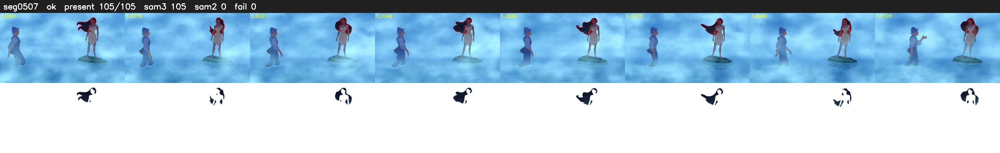

# Segment 507 (shot)

Film frames 45194-45298 (105 frames, 31:25.0-31:29.3).

**Status: ok**

| | |
|---|---|
| Frames with her hair | 105 / 105 |
| Mask source | SAM3 105, SAM2 fallback 0 |
| Frames still failing QC | 0 [] |
| Film indices with no picture (held) | 0 |
| Time | 152 s |

Top: source with the final mask outlined in red. Bottom: white-fill output.

## Issues

- tinted scene: median hair purity 0.11 < 0.5, purity/missed QC off
