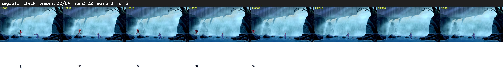

# Segment 510 (shot)

Film frames 45399-45462 (64 frames, 32:33.5-32:36.2).

**Status: check**

| | |
|---|---|
| Frames with her hair | 32 / 64 |
| Mask source | SAM3 32, SAM2 fallback 0 |
| Frames still failing QC | 6 [3, 23, 24, 34, 35, 36] |
| Film indices with no picture (held) | 0 |
| Time | 109 s |

Top: source with the final mask outlined in red. Bottom: white-fill output.

## Issues

- dusk scene: median hair purity 0.61 < 0.75, purity QC off
- fallback 3-3: no seed prompts (cleaned seed too small (370 px): hair lost)
- fallback 23-24: no seed prompts (cleaned seed too small (768 px): hair lost)
- fallback 34-36: no seed prompts (cleaned seed too small (1369 px): hair lost)
- other characters' hair erased on 4 frames
