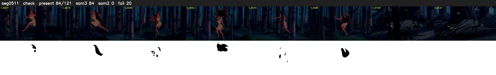

# Segment 511 (shot)

Film frames 45463-45583 (121 frames, 32:36.2-32:41.2).

**Status: check**

| | |
|---|---|
| Frames with her hair | 84 / 121 |
| Mask source | SAM3 84, SAM2 fallback 0 |
| Frames still failing QC | 20 [1, 2, 3, 5, 6, 7, 8, 12, 19, 20, 21, 24, 26, 27, 64, 66, 69, 71, 72, 73] |
| Film indices with no picture (held) | 0 |
| Time | 192 s |

Top: source with the final mask outlined in red. Bottom: white-fill output.

## Issues

- other characters' hair erased on 29 frames
