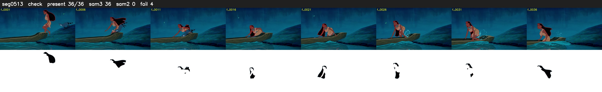

# Segment 513 (shot)

Film frames 45627-45662 (36 frames, 32:43.0-32:44.5).

**Status: check**

| | |
|---|---|
| Frames with her hair | 36 / 36 |
| Mask source | SAM3 36, SAM2 fallback 0 |
| Frames still failing QC | 4 [13, 14, 30, 31] |
| Film indices with no picture (held) | 0 |
| Time | 55 s |

Top: source with the final mask outlined in red. Bottom: white-fill output.
