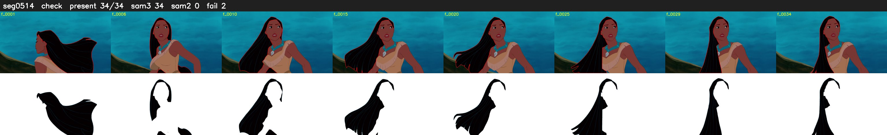

# Segment 514 (shot)

Film frames 45663-45696 (34 frames, 32:44.5-32:45.9).

**Status: check**

| | |
|---|---|
| Frames with her hair | 34 / 34 |
| Mask source | SAM3 34, SAM2 fallback 0 |
| Frames still failing QC | 2 [1, 2] |
| Film indices with no picture (held) | 0 |
| Time | 53 s |

Top: source with the final mask outlined in red. Bottom: white-fill output.

## Issues

- dark scene: 76% of frames fail 'missed', missed QC off
