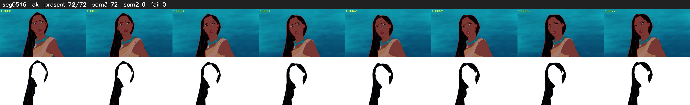

# Segment 516 (shot)

Film frames 45775-45846 (72 frames, 32:49.2-32:52.2).

**Status: ok**

| | |
|---|---|
| Frames with her hair | 72 / 72 |
| Mask source | SAM3 72, SAM2 fallback 0 |
| Frames still failing QC | 0 [] |
| Film indices with no picture (held) | 0 |
| Time | 110 s |

Top: source with the final mask outlined in red. Bottom: white-fill output.
