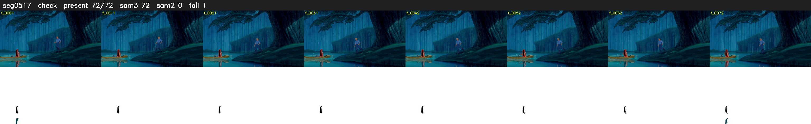

# Segment 517 (shot)

Film frames 45847-45918 (72 frames, 32:52.2-32:55.2).

**Status: check**

| | |
|---|---|
| Frames with her hair | 72 / 72 |
| Mask source | SAM3 72, SAM2 fallback 0 |
| Frames still failing QC | 1 [71] |
| Film indices with no picture (held) | 0 |
| Time | 151 s |

Top: source with the final mask outlined in red. Bottom: white-fill output.

## Issues

- fallback 71-71: no seed prompts (cleaned seed too small (2307 px): hair lost)
- other characters' hair erased on 60 frames
