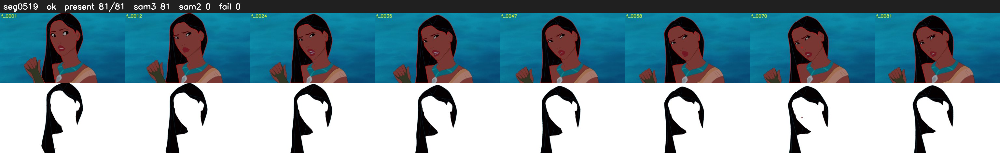

# Segment 519 (shot)

Film frames 46003-46083 (81 frames, 32:58.7-32:02.1).

**Status: ok**

| | |
|---|---|
| Frames with her hair | 81 / 81 |
| Mask source | SAM3 81, SAM2 fallback 0 |
| Frames still failing QC | 0 [] |
| Film indices with no picture (held) | 0 |
| Time | 126 s |

Top: source with the final mask outlined in red. Bottom: white-fill output.
