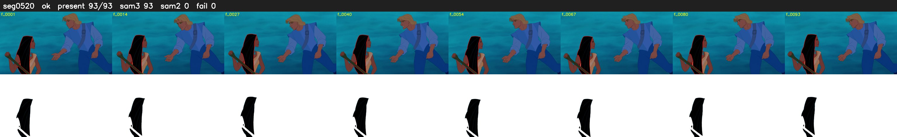

# Segment 520 (shot)

Film frames 46084-46176 (93 frames, 32:02.1-32:06.0).

**Status: ok**

| | |
|---|---|
| Frames with her hair | 93 / 93 |
| Mask source | SAM3 93, SAM2 fallback 0 |
| Frames still failing QC | 0 [] |
| Film indices with no picture (held) | 0 |
| Time | 139 s |

Top: source with the final mask outlined in red. Bottom: white-fill output.
