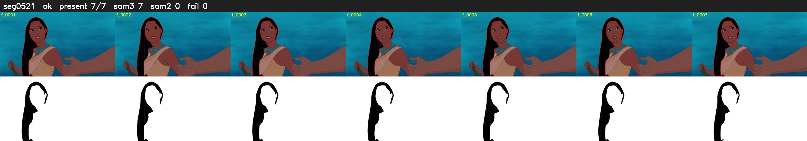

# Segment 521 (shot)

Film frames 46177-46183 (7 frames, 32:06.0-32:06.3).

**Status: ok**

| | |
|---|---|
| Frames with her hair | 7 / 7 |
| Mask source | SAM3 7, SAM2 fallback 0 |
| Frames still failing QC | 0 [] |
| Film indices with no picture (held) | 0 |
| Time | 13 s |

Top: source with the final mask outlined in red. Bottom: white-fill output.
