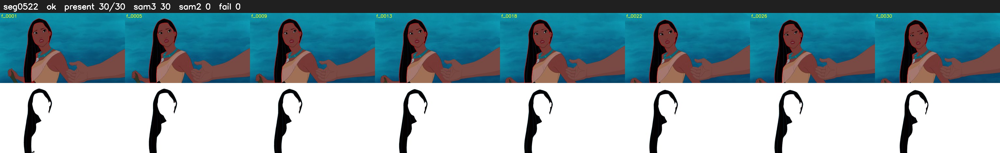

# Segment 522 (transition)

Film frames 46184-46213 (30 frames, 32:06.3-32:07.5).

**Status: ok**

| | |
|---|---|
| Frames with her hair | 30 / 30 |
| Mask source | SAM3 30, SAM2 fallback 0 |
| Frames still failing QC | 0 [] |
| Film indices with no picture (held) | 0 |
| Time | 45 s |

Top: source with the final mask outlined in red. Bottom: white-fill output.
