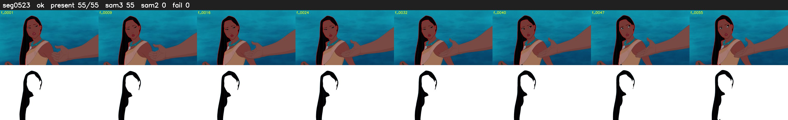

# Segment 523 (shot)

Film frames 46214-46268 (55 frames, 32:07.5-32:09.8).

**Status: ok**

| | |
|---|---|
| Frames with her hair | 55 / 55 |
| Mask source | SAM3 55, SAM2 fallback 0 |
| Frames still failing QC | 0 [] |
| Film indices with no picture (held) | 0 |
| Time | 83 s |

Top: source with the final mask outlined in red. Bottom: white-fill output.
