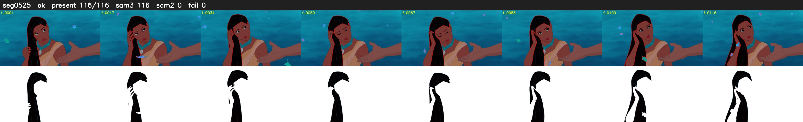

# Segment 525 (shot)

Film frames 46306-46421 (116 frames, 32:11.3-32:16.2).

**Status: ok**

| | |
|---|---|
| Frames with her hair | 116 / 116 |
| Mask source | SAM3 116, SAM2 fallback 0 |
| Frames still failing QC | 0 [] |
| Film indices with no picture (held) | 0 |
| Time | 174 s |

Top: source with the final mask outlined in red. Bottom: white-fill output.
