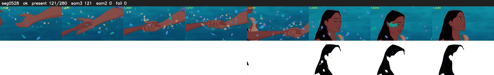

# Segment 528 (shot)

Film frames 46533-46812 (280 frames, 32:20.8-33:32.5).

**Status: ok**

| | |
|---|---|
| Frames with her hair | 121 / 280 |
| Mask source | SAM3 121, SAM2 fallback 0 |
| Frames still failing QC | 0 [] |
| Film indices with no picture (held) | 0 |
| Time | 406 s |

Top: source with the final mask outlined in red. Bottom: white-fill output.

## Issues

- other characters' hair erased on 114 frames
