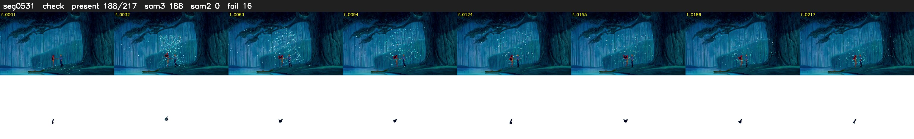

# Segment 531 (shot)

Film frames 47059-47275 (217 frames, 33:42.8-33:51.8).

**Status: check**

| | |
|---|---|
| Frames with her hair | 188 / 217 |
| Mask source | SAM3 188, SAM2 fallback 0 |
| Frames still failing QC | 16 [39, 40, 117, 118, 119, 120, 165, 166, 167, 168, 169, 170, 171, 172, 173, 174] |
| Film indices with no picture (held) | 0 |
| Time | 354 s |

Top: source with the final mask outlined in red. Bottom: white-fill output.

## Issues

- dusk scene: median hair purity 0.71 < 0.75, purity QC off
- fallback 39-40: no seed prompts (cleaned seed too small (0 px): hair lost)
- fallback 117-120: no seed prompts (cleaned seed too small (0 px): hair lost)
- fallback 165-174: no seed prompts (cleaned seed too small (0 px): hair lost)
