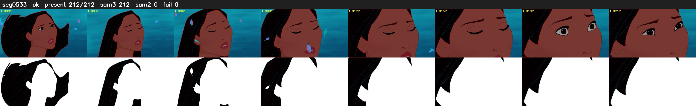

# Segment 533 (shot)

Film frames 47314-47525 (212 frames, 33:53.4-33:02.2).

**Status: ok**

| | |
|---|---|
| Frames with her hair | 212 / 212 |
| Mask source | SAM3 212, SAM2 fallback 0 |
| Frames still failing QC | 0 [] |
| Film indices with no picture (held) | 0 |
| Time | 356 s |

Top: source with the final mask outlined in red. Bottom: white-fill output.
