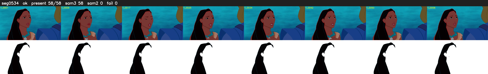

# Segment 534 (shot)

Film frames 47526-47583 (58 frames, 33:02.2-33:04.6).

**Status: ok**

| | |
|---|---|
| Frames with her hair | 58 / 58 |
| Mask source | SAM3 58, SAM2 fallback 0 |
| Frames still failing QC | 0 [] |
| Film indices with no picture (held) | 0 |
| Time | 86 s |

Top: source with the final mask outlined in red. Bottom: white-fill output.
