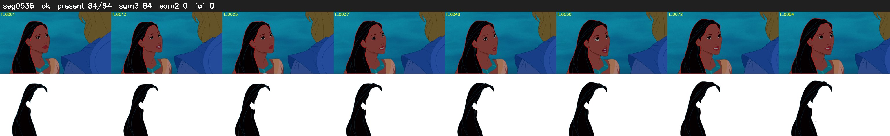

# Segment 536 (shot)

Film frames 47646-47729 (84 frames, 33:07.2-33:10.7).

**Status: ok**

| | |
|---|---|
| Frames with her hair | 84 / 84 |
| Mask source | SAM3 84, SAM2 fallback 0 |
| Frames still failing QC | 0 [] |
| Film indices with no picture (held) | 0 |
| Time | 129 s |

Top: source with the final mask outlined in red. Bottom: white-fill output.
