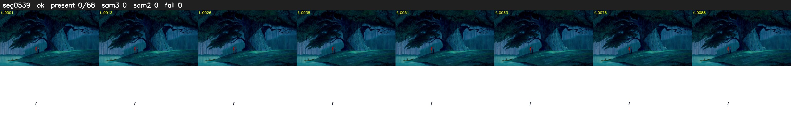

# Segment 539 (shot)

Film frames 47882-47969 (88 frames, 33:17.1-33:20.7).

**Status: ok**

| | |
|---|---|
| Frames with her hair | 0 / 88 |
| Mask source | SAM3 0, SAM2 fallback 0 |
| Frames still failing QC | 0 [] |
| Film indices with no picture (held) | 0 |
| Time | 142 s |

Top: source with the final mask outlined in red. Bottom: white-fill output.
