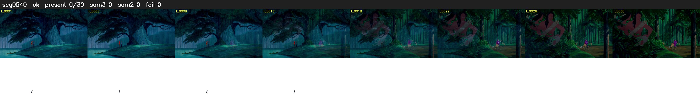

# Segment 540 (transition)

Film frames 47970-47999 (30 frames, 33:20.7-33:22.0).

**Status: ok**

| | |
|---|---|
| Frames with her hair | 0 / 30 |
| Mask source | SAM3 0, SAM2 fallback 0 |
| Frames still failing QC | 0 [] |
| Film indices with no picture (held) | 0 |
| Time | 61 s |

Top: source with the final mask outlined in red. Bottom: white-fill output.

## Issues

- other characters' hair erased on 17 frames
